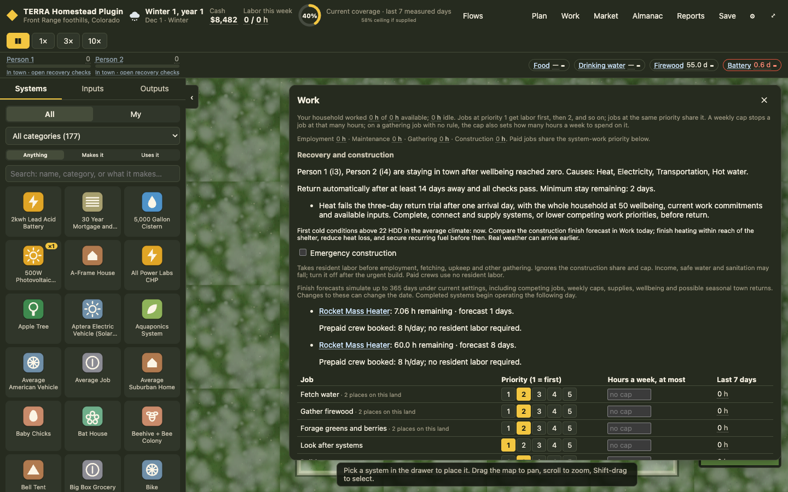
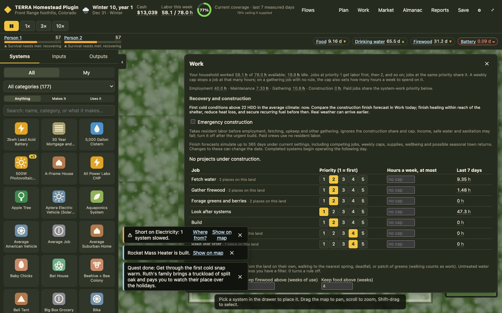
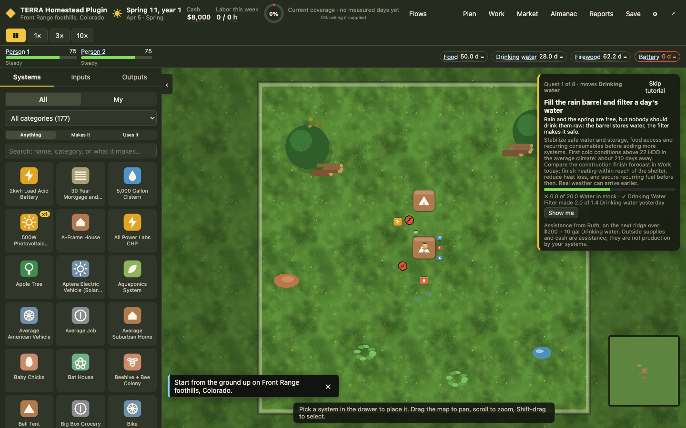
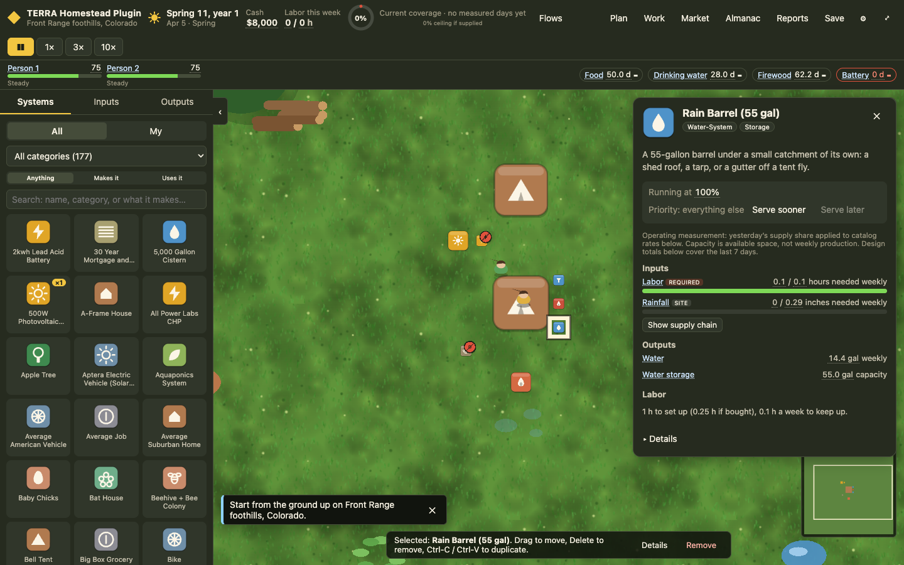

# Phase 2 — Survival recovery

Implemented on `codex/phase-0-1`, following Phase 0/1 commit `17a17a3`. Local changes only; no push or upstream PR.

## LL-04: Emergency construction and town recovery

Work now lists actual construction projects, their remaining hours, a finish forecast, and outside crew quotes. Finish forecasts simulate current work priorities, weekly caps, employment, gathering, supplies, wellbeing and possible seasonal returns, up to 365 days. They are estimates under current settings, not guaranteed dates.

Emergency construction gives the construction queue resident labor before employment, maintenance and fetching, and bypasses its normal share and weekly cap. The warning names those tradeoffs. It is a queue-wide switch; projects retain placement order. Turn it off after the urgent project.

A prepaid outside crew works eight hours per day per project at $35/hour. It supplies construction only, and never contributes to resident labor statistics. Missing cash is shown explicitly. Removal refunds unworked crew hours; worked hours remain spent. The purchase and refund follow existing cash ledger accounting. Booking a crew clears undo/redo, and is an explicit replayable action.

The policy is deliberately finite and costly: an untouched DIY Rocket Mass Heater takes eight days and $2,100 of outside labor, in addition to its $600 purchase cost. That is a premium over the remote job's $25/hour nominal income, and consumes about a third of the $8,000 starting budget including the system. Multiple crews may work in parallel when fully prepaid. These are initial balance parameters, not catalog price edits.

Town recovery now checks the whole household's completed shelter, seven days of prepared Food and three days of safe drinking water. A deterministic return trial simulates the returning household at 50 wellbeing, including its actual employment and gathering commitments, available inputs and spatial delivery. After one arrival day to restart services carried from yesterday's production, the following three days must meet the existing survival thresholds for drinking water, food, shelter, heat on cold days, and sanitation. The arrival allowance is explicit; the trial mutates no live state. All returning residents must finish the 14-day minimum stay. Survival counters reset on return.

This avoids both observed traps: returning to an unchanged cold household, and demanding that labor-dependent stoves and sanitation run while nobody is home. Work lists failed checks; the people bar links directly to them.

## LL-05: Survival-first guidance

Current shortages of safe water, food, heat, shelter and sanitation appear immediately, ahead of weekly design advice. Hot-weather cooling follows survival needs. Alerts name affected residents and group the household issue. They show the supply deficit, the grace deadline, the consequence, resource sources and a Work link. Any departure projection is explicitly an extrapolation of yesterday's net wellbeing change, which can change when grace periods expire.

Town recovery takes precedence over cooling, transportation and annual independence gaps. Low Carbon and Chicken feed stock warns at seven days of full demand or less, with access to sources, standing orders and work rules; future orders, substitutions and gathering are not counted as stock.

Season/year reports show their absolute-day window, resident wellbeing and labor factor separately. Daily averages exclude empty-home days; those days no longer imply full resident health. Current wellbeing remains visible in the people bar.

## LL-06: Tutorial clarity

Show me selects an owned completed system first, then an owned construction project, before opening a purchase. Gathering instructions explain the weekly cap or reserve rule that initiates work. The water automation quest now promises only to configure a seven-day target; its status explicitly says this does not prove a reserve exists. Storage constraints remain visible in Work.

The tutorial displays stabilization guidance and the average-climate cold deadline from its first quest, independent of progress to the late winter quest. Work shows the same deadline beside construction forecasts. Rewards show their amounts and identify outside assistance. Quest IDs, goal thresholds, order and rewards remain unchanged, preserving tutorial progress and replay history.

## Save and replay compatibility

Engine version is `0.2.0`; the save schema remains `homestead.save.v1` / `homestead.game.v1`.

The safer return rule is recorded as `settings.safeRecovery`. Historic logs without that setting retain their original return semantics and digests. New UI games enable it. Continuing an older save first verifies its original replay, then appends a settings action at the continuation day to enable the safer rule. Read-only loads do not migrate. The load message explains the upgrade. Engine clients constructing games directly should opt into `safeRecovery: true` for the new policy.

The spring and winter historical replay digests remain `9544bdc2fdf7f9cf` and `f90dc93c4f4d1a4a`. No fixtures, catalog quantities, goldens or existing tests were weakened or re-recorded.

## Release scenarios

- Day-240 winter fixture: $10,828.94 cash, both residents away, zero resident labor. The two stalled heaters quote $247.05 / one day and $2,100 / eight days.
- With no repair, the safer continuation has no return over the next 21 days while cold conditions persist.
- Booking both crews, prioritizing system work over gathering, and securing recurring fuel, Carbon and groceries brings both residents home. After 30 days they remain home above 50 wellbeing, with the remote job retained and worked.
- Insufficient cash prevents booking and states the exact missing amount.
- Emergency construction overrides a zero construction cap, displaces employment and gathering, and restores normal allocation when switched off.
- Finish forecasts and return trials leave the original state unchanged. Crew purchases replay deterministically.
- The recorded water failure remains reproducible; configuration wording, storage warnings and assistance amounts explain what the target does and does not guarantee.

## Validation

256 unit tests pass; typecheck, lint, build and catalog parity pass. All 15 pacing groups pass under both legacy and safer return policies, across three sites and three seeds. The browser sweep and focused reruns pass 47 of 49 scenarios; the tablet drawer-collapse and outhouse map-card failures previously reproduced on baseline `60fad89` remain open. See `BUILD_LOG.md` for the full-run and rerun details.

Screenshots:

## Limits for later review

The return trial is four simulated days, not a guarantee that winter fuel or cash lasts indefinitely. Thresholds use the existing survival rules (for example, 50% heat), not full comfort. Prepared Food is intentionally required for the return reserve; future harvests do not qualify. Queue-wide emergency priority does not reorder projects. No automatic outside rescue is purchased. Report reconstruction after loading remains outside this phase. Phase 3 project previews and placement remain next on the roadmap.
