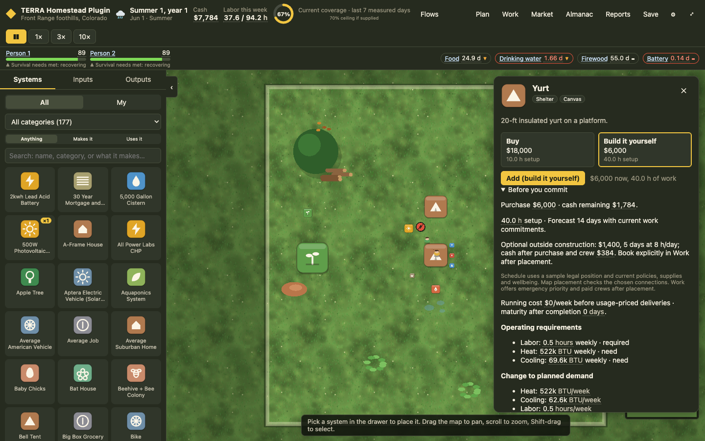
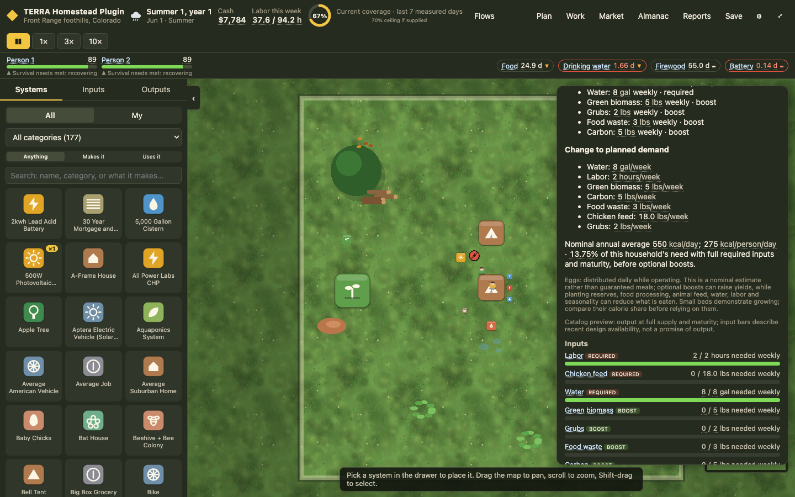
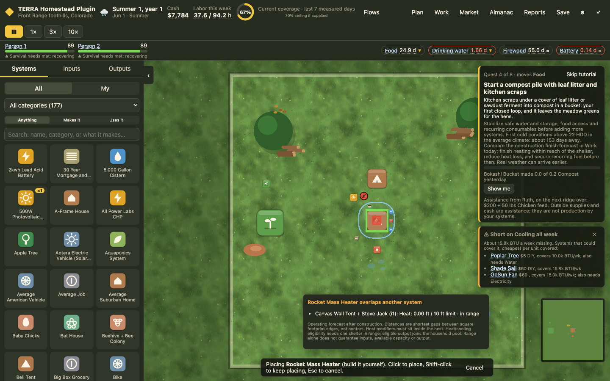
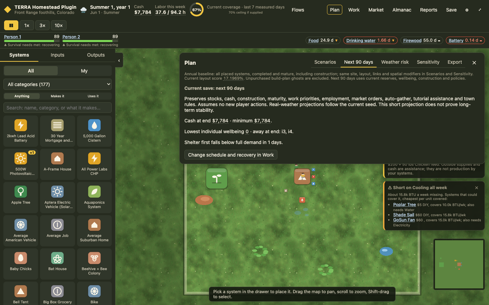
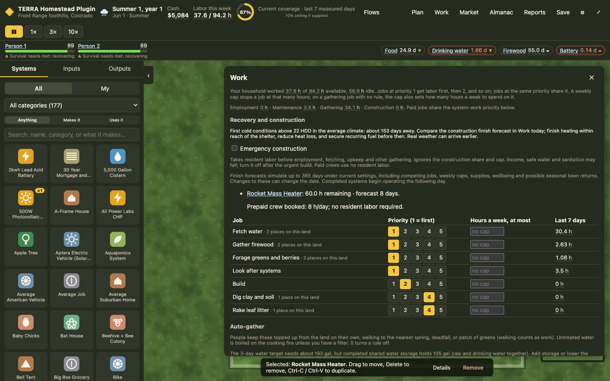

# Phase 3 — Project decisions, placement and planning

Continued locally on `codex/phase-0-1`, after Phase 2 commit `bdb5fb4`. No push or upstream PR.

## LL-07: Preview the net effect before committing

Catalog cards now include an expanded “Before you commit” section for the selected buy/DIY mode:

- Purchase price, cash remaining, setup hours and a simulated finish estimate under current commitments.
- An optional outside-crew quote, duration and cash remaining after both purchase and crew, before either is booked.
- One-time materials, missing stock and the current construction rule: shortages are brought in without a separate market charge.
- Recurring inputs, operating money demand and days to full maturity.
- Changes to the household design's demand, including capacity distinguished from weekly consumption.
- Annual-average added heat demand, the project's coldest-average-day request, and the household cold-day gap even with full inputs and nominal delivered heat.
- Nominal food calories per day, per adult equivalent and as a share of household food demand. These are nominal estimates at full required inputs and maturity, before optional boosts, meal processing and planting reservations. Daily rates use the live engine's weekly ÷ 7 conversion.
- Timing: growing-season distribution, daily operation, or daily production within a seasonal window. In this engine a harvest event marks the start of a window; it is not a single annual food payment.

On the actual spring fixture, a DIY yurt spends $6,000 of $7,784, leaving $1,784. A five-day crew costs another $1,400, leaving $384. The yurt adds about 522,000 BTU/week of annual-average heat demand, and the displayed full-input cold-day household heat gap is about 144,000 BTU/day. Every completed shelter requests heat, even when unused; buying a new one does not replace the old shelter. Occupancy and mothballing were investigated but not introduced as an untested balance change.

For two adults, the 24 sq ft bed's nominal annual average is about 3.7 kcal/person/day (0.1854% of demand); the coop's is about 275 kcal/person/day (13.75%), before optional boosts, unmet feed, water, labor and meal-chain losses. Required inputs and growing seasons are visible beside those numbers. This makes a demonstration bed distinguishable from a substantial food supply.

A sample legal position is used for the card's schedule and demand calculation. Spatial modifiers can depend on it. Long cards open at the top so the budget remains visible while preserving the existing keyboard Add shortcut. Small food shares use fractional percentages instead of rounding to zero. The card labels the position assumption; the map checks the actual chosen point before purchase. Finish forecasts are bounded at 365 days and can change with work policies, supply, wellbeing and seasonal town returns.

## LL-08: Show spatial connections during placement and movement

The map draws operating ranges and highlights connected targets while placing or dragging a system. A separate readout shows footprint validation, relevant targets, exact range classification and engine spatial notes. An overlapping heater can be in operating range while still failing placement validation; an unconnected legal spot is warned about but remains allowed.

Distance is the shortest gap between square footprint edges. Near a cutoff, text uses an inequality and the actual inside/outside margin, avoiding a rounded “10 ft” that is simultaneously described as out of range. Existing assigned-capacity and heater notes use the same formatting. Host effects instead explain the requirement for the source center to sit inside its host; parcel effects have no distance limit.

Forecasts assume planned construction is completed, and mark targets that are still building. Range alone does not guarantee inputs or spare capacity. The current heat/cooling rule requires at least one shelter in range, then pools eligible output against the household load; the overlay explains this rule rather than implying separate per-shelter thermal allocation. Moving a capacity consumer preserves instance allocation order, including competition between two collectors sharing a scarce roof. Group movement checks all selected footprints against outside obstacles.

The selected-system range layer is now attached to the scene, along with the placement overlay. Before this change `syncSpatial` drew into a graphics object absent from the scene's child list; the relevant setup and display path were inspected directly.

## LL-09: Make Plan baselines and outcomes interpretable

Scenarios and Sensitivity reconstruct the same planned layout, site, links and spatial modifiers and display a common annual baseline. All placed systems are treated as completed and mature; unpurchased build-plan ghosts are excluded. Scenario comparison includes purchase/cheapest replacement cost, full catalog setup hours, ongoing labor, available labor and annual cash requirements. These are whole-design replacement requirements, not cash left in a save.

Sensitivity shows four-decimal percentages and explicit percentage-point deltas. It distinguishes a factor with no modeled flow changes from one whose flows change while the capped/limited overall score stays fixed. A controlled solar fixture verifies a nonzero sun response and inactive wind response.

Weather risk displays the policies it actually simulates: mature completed systems on Jan 1; fresh default reserves (28,000 kcal prepared Food, 20 gal safe water and 100 gal raw water); $100,000 cash; default work priorities; no caps, auto-gather, standing orders or tutorial assistance. Placed jobs and backstops operate with actual inputs. Wellbeing changes, but residents do not leave. Current stocks, construction and policies are not inherited. This daily model can differ from steady annual balance. Results identify their run snapshot and warn if the current layout has changed.

“Next 90 days” separately runs the actual current save, preserving cash, stocks, construction, maturity, work priorities, employment, market orders, auto-gather, tutorial rewards and town rules. It shows projected cash/minimum cash, minimum individual wellbeing, residents away at the end, first essential deficit and project completion days. It assumes no additional player actions and follows the current weather seed; it does not claim long-term stability.

## Forecast state isolation

Full-state regression tests found that daily gathering shared the previous state's `nodeStock` object. A projection could therefore consume natural resources in the live save. `git blame` traced that assignment to imported baseline `60fad89` (`time/step.ts`, original line 1326). This also matters to Phase 2 construction and return trials.

Daily stepping now copies the node-stock map before gathering. Tests compare the entire original state before and after project previews, placement previews and transition forecasts, and directly verify gathering leaves an earlier save untouched. A separate regression compares scarce-roof move previews with the actual spatial allocator.

Engine version is `0.3.0`; save schema and catalog quantities are unchanged. Historic spring/winter replay digests remain `9544bdc2fdf7f9cf` and `f90dc93c4f4d1a4a`. No goldens or recorded fixtures were re-recorded. Action logs recorded under 0.2 that exercised return trials with the shared node-stock map can replay differently after this correction; the loader retains its existing verification and snapshot fallback. The imported legacy fixtures still reproduce exactly.

## Validation and review

269 unit tests pass, including 13 new regressions. Typecheck, lint, production build and catalog parity pass. All legacy pacing groups and the safer-policy pacing groups pass across three sites and three seeds. The full browser sweep passes 51/53 scenarios; the two failures remain the tablet drawer-collapse and outhouse-selection tests reproduced on baseline `60fad89` during Phase 0/1. The final targeted rerun passes 6/6 (all four Phase 3 flows and both unchanged keyboard scenarios). No assertions were removed or weakened. The four new Phase 3 browser flows cover pre-purchase figures, reach/overlap and dragging, common baselines/non-mutating forecasts, and an actual funded heater purchase and crew schedule.

The release flow reads a $600 heater purchase plus $2,100/eight-day crew quote before committing, checks reach at the actual spot, places it, books the crew, verifies $5,084 remaining and finishes in eight days. No trial purchase is needed to discover the crew price, labor requirement or reach.

## Next phase

Phase 4 remains balance work: compare controlled strategies and measure reserves, cash runway, labor contention, hardship, recovery and tutorial subsidy before changing startup quantities or progression. The small-bed calorie share and yurt-plus-crew budget are now visible inputs to that work. No startup supplies, rewards, catalog prices or wellbeing thresholds were tuned in Phase 3.
