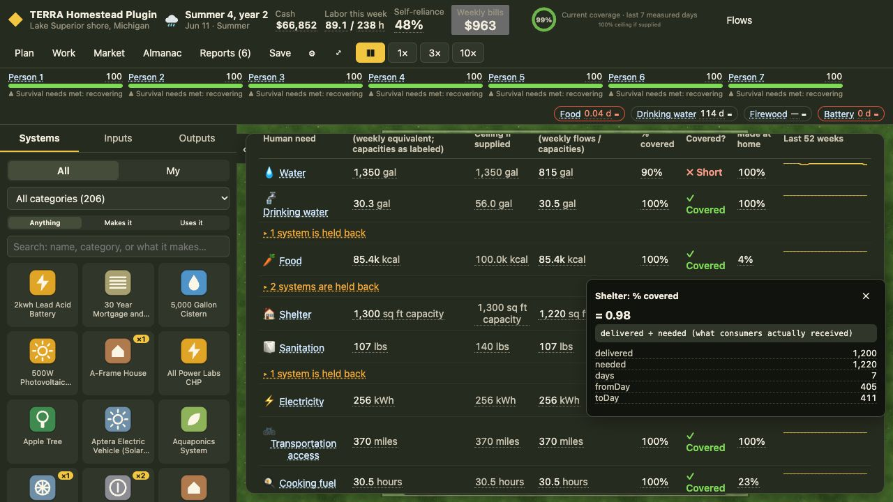
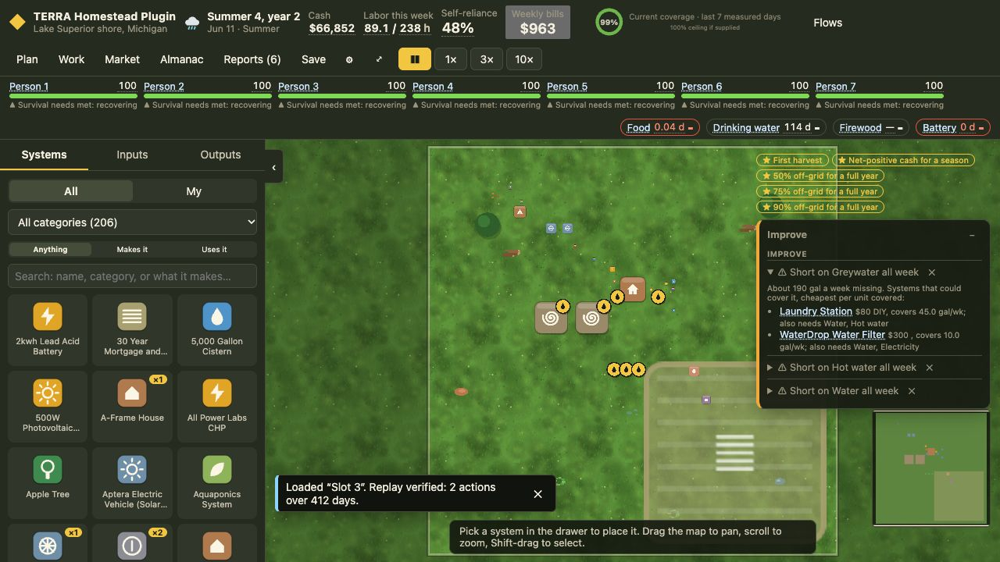

# Batch A validation — October 25, 2026

Engine **0.27.0**, branch `codex/batch-a-household-fixes`. Implements LL-52–54 in the [mini roadmap](../../../MINI-ROADMAP-FIXES.md). No catalog, balance, dependency or new-feature changes.

## Behavior verified

- Four-adult greenfield uses both supplied tents when occupancy is enabled: day-3 shelter remains **448 / 800 sq ft (56%)**, rather than dropping to 28%. Starter assignments persist through save/load and replay; explicit moves, null assignments and deleted-home choices are preserved. Bought homes are excluded from the starter allocation. Single-home starts keep their original default-assignment behavior.
- A two-adult, two-child farm requests **6,800 kcal/day** in the ledger and Food HUD. Coop previews use **3.4 adult equivalents**. The cabin example, with everyone explicitly assigned to its cabin, requests **820 sq ft** and delivers **700**, rather than 574. Tests cover children, elders, instance scales, people in town and the disabled Household roles gate.
- Grocery warnings use a read-only empty-pantry allocator probe. They require delivered meals, actual purchases, operating inputs/access/capacity and more than a week of projected net funding, as well as historical cash runway. The projected-cost check matters when an existing pantry has hidden the future grocery bill from spending history. Removing groceries, blocking roads, starving transport, reducing capacity or exhausting cash retains the warning.
- Legacy simulation behavior remains behind an absent `householdCorrectness` setting. New games enable it; continuing saves records the transition as a settings action. Read-only loads do not upgrade. See [save compatibility](../SAVES.md#batch-a-household-fixes-0270).

## Twelve controlled first years

Six sites × four-adult greenfield novice bot / four-adult, three-child farm observer, 365 days each. All households remain home. Farm meals are fully met every day and no food-runway warning appears on any morning. The permanent regression tests enforce these outcomes. The greenfield survival check is not a claim that its entire tutorial finishes in year one. [Raw measurements](2026-10-25-batch-a-results.json).

| Site | Greenfield end cash | Farm end cash | Residents away, both runs |
|---|---:|---:|---:|
| front-range | $15,298 | $61,188 | 0 / 0 |
| laramie-wy | $14,378 | $60,530 | 0 / 0 |
| asheville-nc | $15,603 | $61,669 | 0 / 0 |
| tucson-az | $14,735 | $61,779 | 0 / 0 |
| olympia-wa | $15,902 | $61,321 | 0 / 0 |
| marquette-mi | $15,414 | $60,642 | 0 / 0 |

The largest farm supplies 800 + 250 + 250 sq ft. Its four adults each need 200 and its three children each need 140; there is no perfect whole-resident packing into those homes. Exhaustive deterministic starter assignment minimizes the gap to **20 sq ft**, delivering **1,200 / 1,220 (98.36%)**. A smaller two-adult, two-child family fits its farmhouse fully. Changing capacities or allowing a resident to occupy multiple homes would change balance or mechanics and was not done.

## Browser verification

Eight relevant Playwright specs pass: alerts, household roles, occupancy, Batch A farm needs and saves. Two new browser tests check both starter tents after enablement/reload and a farm family’s measured food/shelter with no false hunger warning.

Manual UI continuation loaded the original playtest’s Lake Superior farm at **day 29**, with four adults and three children. Continued through winter to **day 412**: all seven home at **100 wellbeing**, **$66,852**, Food **100%** covered and Shelter **98%**. Saved into the previously empty slot 3 and loaded it; the UI reported **“Replay verified: 2 actions over 412 days.”** The Food HUD still labels its low *stored reserve*; working grocery supply prevents the imminent-hunger alert. Browser tab and temporary dev server were closed afterward.

## Checks

- Full unit/parity/determinism/performance suite: **810/810** in 72 files before the final projected-grocery-cost refinement.
- Final alert refinement: **77/77** tests in four files: 23 focused engine tests, 33 recovery tests, nine six-site alert-coverage tests and twelve household pacing tests. No existing tests were deleted or weakened.
- Typecheck, lint and production build pass after the final source change.
- Relevant browser tests: **8/8** on the final build.
- Strategy comparisons pass; committed headline digest remains **066c221e57b1**. No baseline, comparison report or comparison policy was changed.
- `git diff --check` passes. Earlier tracked browser screenshots were restored byte-for-byte after testing; only Batch A screenshots are added.

This was a focused maintenance validation. The complete 87-test browser suite was not run. Fresh Standard greenfield winter survival is covered by the six-site bot regressions; this implementation session’s manual winter play was the continued mixed-age farm, rather than a second full manual greenfield tutorial. Batches B and C remain unimplemented.
