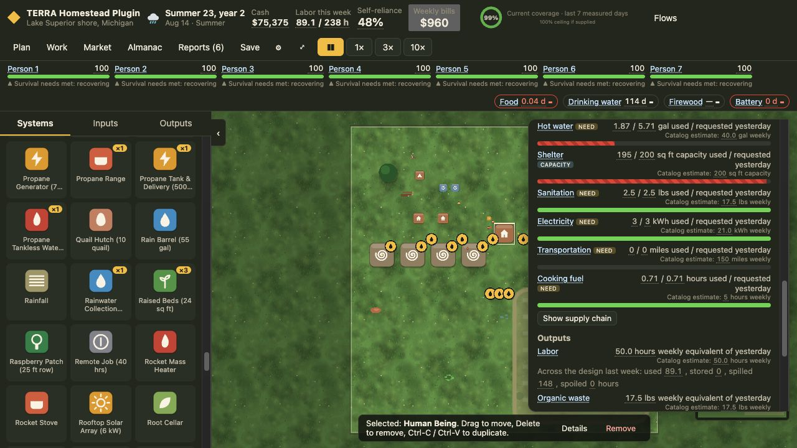
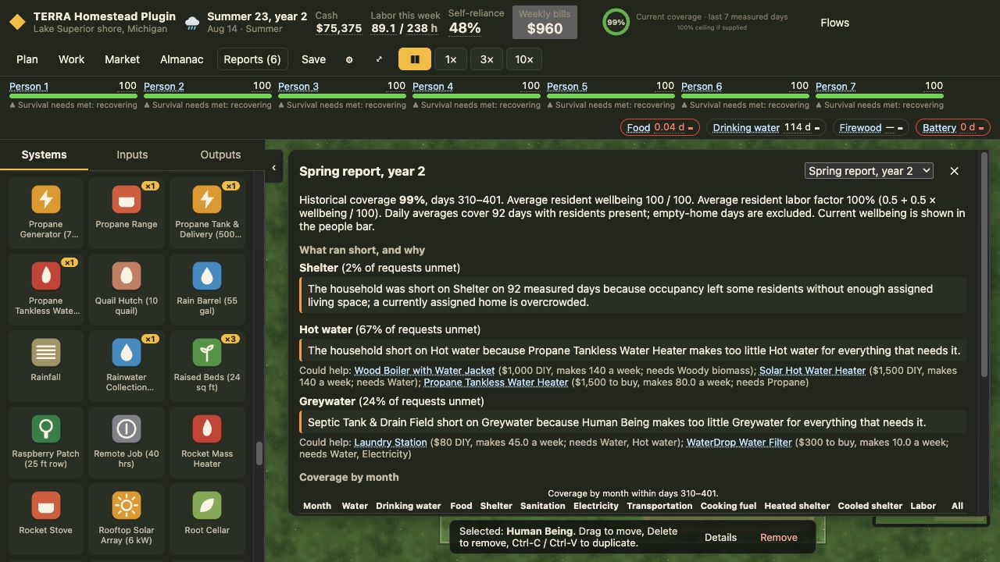

# Batch B — trustworthy decisions

October 26, 2026. Engine **0.27.1**, branch `codex/batch-b-decision-fixes`. Implements LL-55–57 in the [mini roadmap](../../../MINI-ROADMAP-FIXES.md). Batch A remains in the working tree; no catalog values, dependencies, balance constants or new mechanics were added.

## Behavior

- **LL-55:** farm and cabin no longer require an impossible tutorial completion to barter. Skipped greenfield onboarding also unlocks existing goods and spare-labor barter. An unfinished active tutorial still blocks barter, completing it still unlocks barter, and engine validation still requires Selling and trade. Regression tests fulfill both goods and labor orders and verify replay and JSON continuation. Browser tests exercise all three starts through exported-save import.
- **LL-56:** placed cards display yesterday’s actual input use and request, and realized output expressed as an explicitly labeled equivalent in its catalog period. For example, a weekly number is measured daily output × 7; a seasonal number is converted using the catalog’s weekly factor. These are measurements, not forecasts. Nominal catalog estimates appear separately. Capacity stays a level, construction materials stay one-time, and an unmeasured system is labeled accordingly. Catalog previews retain their original quantities and parity.
- Operating records now retain instance IDs and realized output before daily wear, fertility, health or cohort updates change the next day’s lookup key or multiplier. A newly placed copy cannot borrow an older copy’s measurement. Display metadata is outside the simulation digest. Old snapshots use their existing group record until a new day records the richer measurement. Backstop cash input records include their actual on-demand purchases and connection fees.
- **LL-57:** report candidates now include measured capacity-need gaps from the same summary that supplies the monthly table. Shelter ranks before comfort. Its explanation distinguishes insufficient space, overcrowding and residents without an assigned open home; a fully housed farm has no shelter shortage. Historical shortfall days are distinguished from current assignment diagnostics.

## Regression coverage

`packages/engine/test/batch-b.test.ts` contains 24 cases: trade gates/fulfillment/save/replay; summer and winter heaters, gardens and solar with multiple instances; actual curtailed input use; wear/fertility changes; scaled child labor before health updates; on-demand grocery cash; first unmeasured operation and capacity units; and report ranking/full coverage/overcrowding/unassigned homes. Existing active-tutorial rejection tests now explicitly create active tutorials, retaining the rejection and conservation assertions. The formerly rejected skipped state is covered by the new positive fulfillment and replay cases, as required by LL-55.

`tests/e2e/batch-b.spec.ts` adds four browser cases. Layout review led to wrapping measured numbers and placing catalog estimates on their own line inside the existing card.

## Manual interface check

Loaded the original Lake Superior mixed-age farm’s Slot 3 checkpoint (day 412), with replay verification visible. Existing save slots 1–3 were retained. Barter choices included goods and Labor without a tutorial; a queued hour of work for Carbon completed during continued simulation. That exploratory order was not saved over a manual slot.

After the final operating-record change, reloaded Slot 3, advanced into summer (August 14, year 2), paused, and inspected a placed resident’s measured card. The card displays actual daily input use, capacity units, yesterday’s output equivalents and separate catalog estimates without horizontal overflow. The rebuilt spring report lists Shelter’s 2% shortfall before Hot water and Greywater and identifies current overcrowding. All seven residents remained at 100 wellbeing with funded meals.

## Validation

Final unit suite: **835/835** in **73 files**. Typecheck, lint and production build pass. Strategy comparisons retain headline digest **066c221e57b1**. Final relevant browser checks: **13/13**. The complete browser suite passed 93/93 before the last backstop cash-display refinement; relevant browser tests were then rerun against the final build. Unit checks include parity, determinism, performance, alert coverage, household scaling and the six-site Batch A first-winter regressions. Strategy comparison baselines and policy were not edited.

Manual play in this batch was continued farm observation and targeted interface checks; a fresh greenfield tutorial-through-winter play was not repeated. Batch C’s tutorial and forecast-copy tickets remain outside this implementation.
